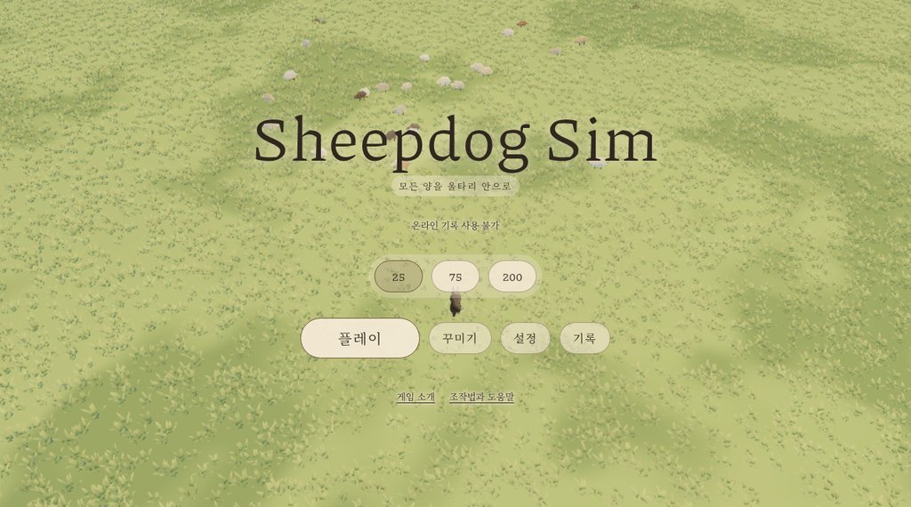
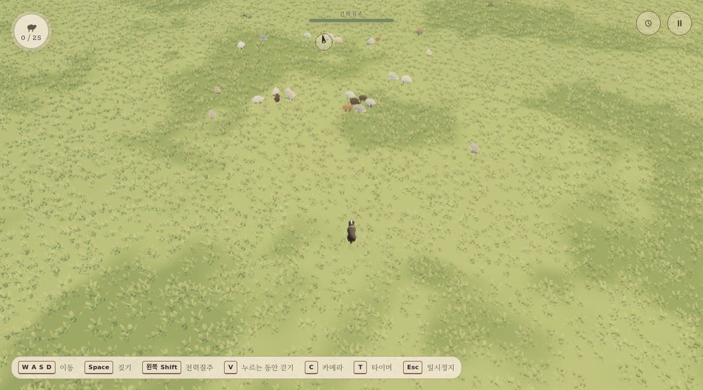

# Sheepdog Sim (양몰이 심) — 한국어판

한 마리의 개, 한 떼의 양, 한 평원. 잔잔한 셀 셰이딩 브라우저 게임으로,
양들을 이끌어 울타리 안으로 몰아넣는 게임입니다. 양떼 뒤에서 천천히 접근하고,
적절한 타이밍의 짖기로 흩어진 양들을 집으로 데려오세요.

**[지금 플레이하기 (GitHub Pages)](https://sigco3111.github.io/sds/)** ·
[원본 저장소 (matthew-kissinger/sds)](https://github.com/matthew-kissinger/sds)




> 이 저장소는 원작자의 허가 조건(AGPL-3.0)을 지키며 한국어화한 포크입니다.
> 원본 README는 [README.en.md](README.en.md)에 그대로 보존되어 있습니다.

## 목차

- [게임 소개](#게임-소개)
- [플레이 방법](#플레이-방법)
- [한국어화 내용](#한국어화-내용)
- [솔로 전용 안내](#솔로-전용-안내)
- [오디오 교체와 라이선스](#오디오-교체와-라이선스)
- [기술 스택](#기술-스택)
- [로컬 빌드 방법](#로컬-빌드-방법)
- [배포 재현 방법](#배포-재현-방법)
- [라이선스](#라이선스)

## 게임 소개

- **25마리, 75마리, 200마리** 중 양떼 크기를 고르고 모든 양을 우리에 넣으면 완료입니다.
- 키보드·게임패드·터치로 이동, 전력질주, 짖기를 사용합니다.
- 위에서 내려다보는 **클래식** 카메라와 가까이 따라가는 **추적** 시점을 전환할 수 있습니다.
- 월드 내 하이라이트와 화면 밖 방향 표시로 울타리 입구를 안내합니다.
- **꾸미기**에서 개의 털색과 이름, 양 품종을 고르고 양 한 마리 한 마리에 이름을 지어줄 수 있습니다.
- 황금빛 들판, 빽빽한 풀숲, 배치된 나무들, 움직이는 구름, 공간감 있는 사운드를 즐길 수 있습니다.
- 기기에 로컬 최고 기록을 저장합니다.

## 플레이 방법

1. [https://sigco3111.github.io/sds/](https://sigco3111.github.io/sds/)에 접속합니다.
2. 양떼 크기(25/75/200)를 선택하고 **플레이**를 누릅니다.
3. 조작법:

| 동작 | 키보드 | 게임패드 | 터치 |
| --- | --- | --- | --- |
| 이동 | W A S D 또는 방향키 | 왼쪽 스틱 | 왼쪽 조이스틱 |
| 짖기 | Space | 남쪽 버튼 | 짖기 버튼 |
| 전력질주 | 왼쪽 Shift | 오른쪽 트리거 | 질주 버튼 |
| 걷기 | V (누르는 동안) | — | — |
| 카메라 전환 | C | — | — |
| 타이머 표시 | T | — | — |
| 일시정지 | Esc | 시작 버튼 | 일시정지 버튼 |

## 한국어화 내용

- 게임 내 모든 UI: 부팅 화면, HUD, 설정, 꾸미기, 양 등록부, 개별 양 정보, 조작 안내, 그래픽 복구 안내, 터치 컨트롤
- 점수·기록 화면과 공유 문구, 순위 표기("N위")
- 한국어 양 이름 220개, 개 이름 20개, 개 털색 6종, 양 품종 9종과 변종 옵션
- 소개·지원·개인정보·404 정적 페이지와 웹 앱 매니페스트
- 한국어 본문용 Noto Serif KR 서브셋 폰트 추가(실제 사용 글자만 추려 176KB로 경량화)

## 솔로 전용 안내

이 배포는 **정적 호스팅 전용 솔로 빌드**입니다. 원작의 온라인 기능(온라인 기록 비교,
멀티플레이 로비/초대, 소유자 대시보드)은 서버(Cloudflare Workers + D1)가 필요하여
이 정적 배포에서는 동작하지 않습니다. 게임 플레이와 로컬 최고 기록 저장은 정상 동작하며,
화면에 "온라인 기록 사용 불가"가 표시되는 것은 의도된 동작입니다.

## 오디오 교체와 라이선스

원본 저장소의 오디오 14개 파일(Mixkit 2개, ElevenLabs 12개)에는 공개 재배포를 허용하는
라이선스 기록이 없어, 원본의 자산 정책(LICENSE-ASSETS: "재배포 라이선스가 기록되지 않은
자산은 공개 릴리스에 포함할 수 없다")에 따라 **전부 FFmpeg로 합성한 동일 역할의
사운드로 교체**했습니다. 파일명과 용도는 원래대로 유지되며, 상세한 대응표와 합성 방법은
[assets/audio/README.md](assets/audio/README.md)에 기록되어 있습니다.

## 기술 스택

- **렌더링**: Three.js (WebGPURenderer, WebGPU 불가 환경에서는 WebGL2 백엔드로 자동 전환), 셀 셰이딩, GPU 인스턴싱 풀·지형
- **UI**: React 19 + Vite(rolldown)
- **원본 인프라**: Cloudflare Workers + D1 (점수 API) — 이 배포에서는 미사용
- **폰트**: Noto Serif KR (Google Fonts, OFL) 서브셋, Piazzolla (원본 포함)

## 로컬 빌드 방법

요구 사항: Node.js 22+

```bash
git clone https://github.com/sigco3111/sds.git
cd sds
npm ci
npm run build:preview   # 솔로 전용 정적 프리뷰 빌드
```

빌드 결과물(정적 사이트)은 `app/.cloudflare/output/v0/workers/default/assets/`에 생성됩니다.
이 디렉터리를 그대로 정적 호스팅에 올리면 됩니다. 개발 서버는 `npm run dev`입니다.

참고: `vite.config.ts`의 `base`가 `/sds/`로 설정되어 있어 다른 경로에 배포하려면 이 값을
바꾸고 다시 빌드해야 합니다.

## 배포 재현 방법

이 포크의 `gh-pages` 브랜치가 위 빌드 결과물을 담고 있으며, GitHub Pages가
`gh-pages / (root)`를 서비스합니다(루트의 `.nojekyll`로 Jekyll 처리는 꺼져 있습니다).

이 환경의 GitHub 웹 UI 제약으로 인해 배포물에 아래와 같은 이력이 있습니다(재현 시 참고):

1. 웹 업로드는 모든 파일에 연번 접두사(예: `47-`)를 붙여 커밋합니다. 작은 파일은
   업로드 후 파일명을 원래대로 변경했습니다.
2. 1MB를 넘는 파일은 웹 편집기에서 이름을 바꾸면 내용이 비워지는 문제가 있어,
   아래 3개 파일은 접두사가 붙은 이름 그대로 두고 참조를 그 이름에 맞췄습니다.
   - `assets/1-index-BpyLagfH.js` (메인 번들; `index.html`의 `<script src>`가 이 이름을 가리킴)
   - `assets/48-tufts-Dk2H0yBJ.bin` (풀 데이터; 번들 내부 참조가 이 이름으로 패치됨)
   - `assets/53-sheepdog-sim-v2.png` (OG 이미지; 메타 태그 참조)
3. 폰트 2개는 `assets/` 아래에 두고 `index.html`의 `@font-face`/preload가 그 경로를 가리킵니다.
4. 솔로 빌드에서 실행되지 않는 지연 청크 2개(소유자 대시보드, 기록 보기)는 배포물에서 제외했습니다.

빌드 결과물을 새로 배포할 때는 위 1~3의 이름 대응만 동일하게 적용하면 됩니다.

## 라이선스

- 코드: 원본과 동일하게 **AGPL-3.0-or-later** ([LICENSE](LICENSE))
- 자산 정책: [LICENSE-ASSETS](LICENSE-ASSETS) — 상기 사유로 오디오는 합성 대체되었습니다
- 원작: [matthew-kissinger/sds](https://github.com/matthew-kissinger/sds) (원작자 Matthew Kissinger)
- 한국어화 포크: 2026-10-28, 원본 ID·저작자 표기를 유지하며 UI 문자열만 한국어로 번역
